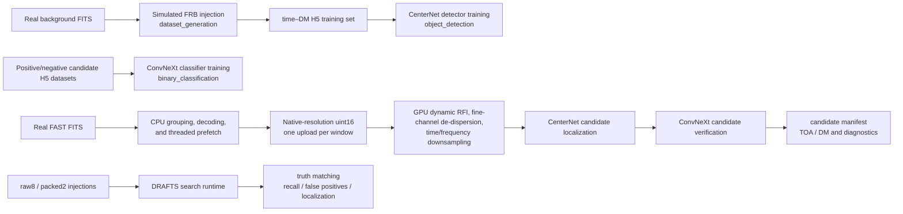

<h1 align="center">DRAFTS</h1>

<div align="center">

**Deep learning-based RAdio Fast Transient Search pipeline**

A deep-learning pipeline for fast radio burst and single-pulse searches

[](https://github.com/SukiYume/DRAFTS)
[](https://github.com/SukiYume/DRAFTS)
[](https://arxiv.org/abs/2410.03200)
[](https://www.python.org/)
[](LICENSE)
[](https://github.com/SukiYume/AFTER)

[Overview](#overview) ·
[Pipeline](#drafts-pipeline) ·
[Quick start](#quick-start) ·
[Training](#model-training) ·
[Search](#searching-real-observation-data) ·
[Injection benchmark](#injection-benchmark) ·
[简体中文](README.md)

</div>

---

## Overview

**DRAFTS** is a Deep learning-based RAdio Fast Transient Search pipeline for
finding fast radio bursts (FRBs) and other single pulses in radio-telescope
observations. It combines accelerated de-dispersion, object detection, and
candidate classification in one trainable and deployable workflow.

The production search has four stages:

1. **FITS organization and prefetching** groups tasks by source/date/beam.
   CPU threads read the current window and upcoming FITS files, and standard
   multi-polarization data combine the first two polarizations during decoding;
2. **GPU de-dispersion and preprocessing** upload each native-resolution window
   once as a compact `uint16` array, then apply dynamic RFI masking,
   fine-channel de-dispersion, and time/frequency downsampling on the GPU;
3. **CenterNet object detection** locates candidates in 512 × 512 time–DM maps
   and estimates time of arrival (TOA) and dispersion measure (DM);
4. **ConvNeXt binary classification** evaluates de-dispersed candidate cutouts
   in bounded batches and selects the final candidates.

This repository contains the current DRAFTS workflows for training-data
generation, CenterNet training, ConvNeXt classifier training, searches of real
FAST observations, and raw8/packed2 injection evaluation.

> Publication:
> [DRAFTS: A Deep Learning-Based Radio Fast Transient Search Pipeline](https://arxiv.org/abs/2410.03200)

### Highlights

- End-to-end coverage from training-data construction to production search;
- GPU-resident RFI processing, fine-channel de-dispersion, downsampling,
  detection, and classification, with DLPack sharing memory between CuPy and
  PyTorch;
- A two-stage detector/classifier design for localization and verification;
- Search entry points organized around real FAST observations;
- Reproducible raw8/packed2 injection campaigns and a PRESTO baseline;
- Public [training data](https://huggingface.co/datasets/TorchLight/DRAFTS) and
  [pretrained models](https://huggingface.co/TorchLight/DRAFTS) on Hugging Face,
  with deployment instructions in each workflow README.

## DRAFTS pipeline



| Workflow | Input | Output |
|---|---|---|
| Model training | Real backgrounds, simulated injections, labels | CenterNet and ConvNeXt checkpoints |
| Observation search | FAST FITS, deployed weights, search parameters | Candidates, TOA/DM estimates, diagnostic images |
| Injection evaluation | Background FITS, injection distributions, search weights | Truth matches, recall/false-positive metrics, PRESTO comparison |

## Repository layout

| Path | Role in DRAFTS |
|---|---|
| [`dataset_generation/`](dataset_generation/) | Inject simulated FRBs into real FAST backgrounds and build 512 × 512 time–DM H5 training sets. |
| [`object_detection/`](object_detection/) | Train, evaluate, and run the current CenterNet detector. |
| [`binary_classification/`](binary_classification/) | Train and evaluate ConvNeXt/SPPConvNeXt candidate classifiers. |
| [`anomaly_detection/`](anomaly_detection/) | Train and evaluate ConvNeXt autoencoder/VAE models for dynamic-spectrum anomaly detection. |
| [`search_pipeline/`](search_pipeline/) | Deployable real-observation search, fixed-DM follow-up, PBS submission, and benchmarks. |
| [`injection_benchmark/`](injection_benchmark/) | raw8/packed2 generation, DRAFTS search, truth matching, aggregation, and the PRESTO baseline. |
| [`requirements.txt`](requirements.txt) | Common Python dependencies; install CUDA packages for the target machine separately. |

Each workflow directory has its own README with detailed parameters, data
contracts, output conventions, and operational notes.

## Quick start

### Prerequisites

- [Git](https://git-scm.com/downloads);
- 64-bit [Python 3.10+](https://www.python.org/downloads/) with `venv` and
  `pip`;
- an NVIDIA GPU with mutually compatible driver, CUDA, PyTorch, and CuPy
  builds for data generation, training, and observation searches;
- local or shared storage for raw FITS, training H5, and search products.

Production launchers and training wrappers use Bash. PBS submission additionally
requires a Linux cluster configured with PBS. Windows can create the Python
environment and run Python entry points; shell wrappers require a Bash
environment.

### 1. Clone the repository

```bash
git clone https://github.com/SukiYume/DRAFTS.git DRAFTS
cd DRAFTS
```

### 2. Create the environment

```bash
python -m venv .venv
source .venv/bin/activate
python -m pip install -U pip
```

Windows PowerShell:

```powershell
python -m venv .venv
.\.venv\Scripts\Activate.ps1
python -m pip install -U pip
```

Use the [official PyTorch selector](https://pytorch.org/get-started/locally/)
to install `torch` and `torchvision` for the target CUDA platform, then install
the repository requirements and the matching CuPy build. For CUDA 12.x:

```bash
python -m pip install -r requirements.txt
python -m pip install -r search_pipeline/requirements.txt
python -m pip install cupy-cuda12x
```

Production-search additions are listed in
[`search_pipeline/requirements.txt`](search_pipeline/requirements.txt).
Run a CUDA smoke test and archive the actual Python, package, GPU, and driver
versions beside every production search:

```bash
python -c "import torch, cupy; print('torch', torch.__version__, 'cuda', torch.version.cuda, 'available', torch.cuda.is_available()); print('cupy devices', cupy.cuda.runtime.getDeviceCount())"
```

### 3. Prepare data and pretrained models

The [training data](https://huggingface.co/datasets/TorchLight/DRAFTS) and
[pretrained models](https://huggingface.co/TorchLight/DRAFTS) are publicly
available on Hugging Face.

The current search runtime uses:

| Task | File | SHA-256 |
|---|---|---|
| CenterNet ConvNeXt-Tiny detector v10 | `object_best_model_centernet_conv_tiny_ema_v10.pth` | `bcad4e710f5f1ccd3c8609d35a8d3fbfc36abd1d85bfefd035e945a573fb0629` |
| ConvNeXt-Small binary classifier | `binary_best_model_conv_small_ema.pth` | `2055745aab76ddc16074516aa7b9aafdfaedf16df37ce8924389573eab27ffd8` |

Download both files directly into `search_pipeline/models/` for observation searches:

```bash
mkdir -p search_pipeline/models
curl -fL \
  -o search_pipeline/models/object_best_model_centernet_conv_tiny_ema_v10.pth \
  https://huggingface.co/TorchLight/DRAFTS/resolve/main/object_best_model_centernet_conv_tiny_ema_v10.pth
curl -fL \
  -o search_pipeline/models/binary_best_model_conv_small_ema.pth \
  https://huggingface.co/TorchLight/DRAFTS/resolve/main/binary_best_model_conv_small_ema.pth
```

The injection benchmark uses the same two files in the runtime location described
in [`injection_benchmark/README.md`](injection_benchmark/README.md).

## Model training

### Generate CenterNet training data

```bash
cd dataset_generation
RAW_DIR=/path/to/background_fits \
GEN_ROOT=/path/to/generated_training_data \
./run_generation.sh
```

The default campaign generates 50,000 unique injected events, four crops per
event, and sharded outputs that limit concurrent FITS I/O. See
[`dataset_generation/README.md`](dataset_generation/README.md) for the injection model,
sampling distributions, merge step, metadata, and validation tools.

### Train the CenterNet detector

```bash
cd object_detection
DATA_PATH=/path/to/centernet_data \
BATCH_SIZE=24 \
EPOCHS=50 \
./train.sh "0,1,2,3,4,5,6,7" centernet-conv-tiny
```

Copy the selected EMA checkpoint to `search_pipeline/models/` before deployment. See
[`object_detection/README.md`](object_detection/README.md) for data formats,
supported backbones, training arguments, and evaluation.

### Train the ConvNeXt classifier

```bash
cd binary_classification
DATA_PATH=/path/to/binary_h5 \
EPOCHS=50 \
./train.sh "0,1,2,3" small
```

The current search workflow commonly uses `convnext_small`; `convnext_tiny`
remains a lighter deployment option. See
[`binary_classification/README.md`](binary_classification/README.md) for data
layout, model selection, and training arguments.

## Searching real observation data

Search code lives in [`search_pipeline/`](search_pipeline/) and can be deployed as a
self-contained runtime directory.

| Task | Entry point |
|---|---|
| Blind search over unknown DM | `d-center-binary-gate.py` or `t-blind-section.py` |
| Known-DM or candidate-DM follow-up | `d-dm-time.py` |
| PBS batch submission | `s-pbsspt.py` |
| Binary-classifier comparison | `t-binary-bench.sh` |

### Production search over unknown DM

Build a task manifest before scanning a large directory tree. Every PBS
section then loads the same manifest without repeating the shared-filesystem
walk. `d-center-binary-gate.py` configures the physical DM grid with `dm_min`,
`dm_range`, and `dm_step`, and automatically adds the FITS overlap required at
section boundaries.

```bash
cd search_pipeline

python c-manifest-build.py \
  --data-path /path/to/fast_observations \
  --beam-filter all \
  --output /path/to/runtime/task_manifest.json

python s-pbsspt.py \
  --script d-center-binary-gate.py \
  --nodes 1:8 \
  --job-name drafts \
  --dry-run
```

Configure the models, DM grid, manifest, output root, and beam selection at the
bottom of `d-center-binary-gate.py`. Inspect the generated PBS files, then
remove `--dry-run` to submit them. The submitter reads `section_num` from the
entry script and distributes logical sections evenly across GPU jobs.
`--workers-per-gpu` separately limits concurrent search processes on each GPU.

Use the command-line wrapper for a single-section check:

```bash
python t-blind-section.py \
  --section 0 \
  --data-path /path/to/fast_observation \
  --output-root /path/to/drafts_search_output \
  --gpu-num 1 \
  --beam M01 \
  --dm-min 0 \
  --dm-range 4096 \
  --dm-step 1
```

Each search process uses `fits_prefetch_workers` CPU threads to read and cache
FITS files. The queue prepares upcoming files while the GPU handles the current
window. Candidate products are written to
`<save_base>/<source>/CentData/<date>/<beam>/`, with absolute MJD, TOA, DM,
model scores, and diagnostic paths recorded in `candidate_manifest.jsonl`.

### Fixed-DM follow-up

`d-dm-time.py` de-disperses at one known DM and applies the binary
classifier at configurable integer time-downsampling rates. The generic entry
defaults to `prob=0.6`, `section_num=32`, and rate `[8]`; multiple valid rates
can be supplied through `down_sampling_rate_list`. Adjacent sliding windows
reuse GPU integer FITS caches. Fine channels are de-dispersed at native sampling
before averaging, preprocessing and classification on the GPU; CPU workers prefetch FITS data.

Outputs use `<save_base>/<source>/CalData/<date>/<beam>/<rate>/`. When the final
component of `save_base` already matches the source name, the entry reuses that
directory and keeps one source component in the path.

Blind searches require detector and classifier checkpoints; fixed-DM searches
require the classifier checkpoint. Place the required files in
`search_pipeline/models/`. The full parameter reference, FITS-prefetch behavior,
manifest workflow, fixed-DM mode, output layout, and troubleshooting guide are
documented in
[`search_pipeline/README.md`](search_pipeline/README.md).

## Injection benchmark

[`injection_benchmark/`](injection_benchmark/) measures DRAFTS search
performance on controlled injected signals. It covers signal generation,
raw8/packed2 searches, truth matching, batch aggregation, and a PRESTO
baseline.

| Component | Purpose |
|---|---|
| `generate_injections.py` | Inject simulated FRBs into real backgrounds and write raw8 and optionally packed2 data. |
| `run_campaign.py` | Orchestrate generation, search, analysis, and aggregation. |
| `launch_search.py` | Launch the injection-specific DRAFTS search runtime. |
| `evaluate_results.py` | Match candidates to truth and calculate recall, false positives, and binned metrics. |
| `aggregate_results.py` | Aggregate analysis products across batches. |
| `search_runtime/` | Minimal search runtime and model-weight placeholders. |
| `presto_runtime/` | PRESTO blind-search baseline and threshold sweeps. |

Start with a small dry run to inspect paths and the execution plan:

```bash
python injection_benchmark/run_campaign.py \
  --background-dir /path/to/background_fits \
  --work-root /path/to/injection_runs \
  --sim-root /path/to/injection_runs/simdata \
  --truth-root /path/to/injection_runs/truth_archive \
  --run-label example_campaign \
  --batches 1 \
  --count-per-batch 32 \
  --gpu-num 1 \
  --gpu-ids 0 \
  --dry-run
```

See [`injection_benchmark/README.md`](injection_benchmark/README.md) for
full generation and search-only runs, weight placement, raw8/packed2 parallel
searches, truth tolerances, and the PRESTO baseline.

## Validation

After installing the environment and downloading the models, run from the
repository root:

```bash
python -c "import numpy, scipy, h5py, astropy, torch, torchvision; print('common imports OK')"
python -c "import torch, cupy; assert torch.cuda.is_available(); print('CUDA devices', torch.cuda.device_count(), cupy.cuda.runtime.getDeviceCount())"
python -c "from pathlib import Path; paths = [Path('search_pipeline/models/object_best_model_centernet_conv_tiny_ema_v10.pth'), Path('search_pipeline/models/binary_best_model_conv_small_ema.pth')]; assert all(p.is_file() for p in paths), paths; print('search weights OK')"
python search_pipeline/s-pbsspt.py --help
python -m compileall -q \
  dataset_generation \
  object_detection \
  binary_classification \
  anomaly_detection \
  search_pipeline \
  injection_benchmark
```

Linux shell entry points can be checked with `bash -n path/to/script.sh`.

## DRAFTS and AFTER

DRAFTS performs **search and candidate selection**. After candidate TOA/DM
values have been confirmed, AFTER continues the FAST workflow with burst
cutting, calibration, label review,
energy measurements, and polarization analysis.

```text
DRAFTS: search and candidate selection
    -> confirmed TOA / DM
AFTER: reduction, calibration and physical measurements
```

## Citation and license

If DRAFTS contributes to your research, cite the
[DRAFTS publication](https://arxiv.org/abs/2410.03200) and record the model
version, checkpoint, data format, and search parameters used in your analysis.

Distributed under the [MIT License](LICENSE).

---

<div align="center">
  <sub>DRAFTS · Searching for fast radio transients with deep learning</sub>
</div>
